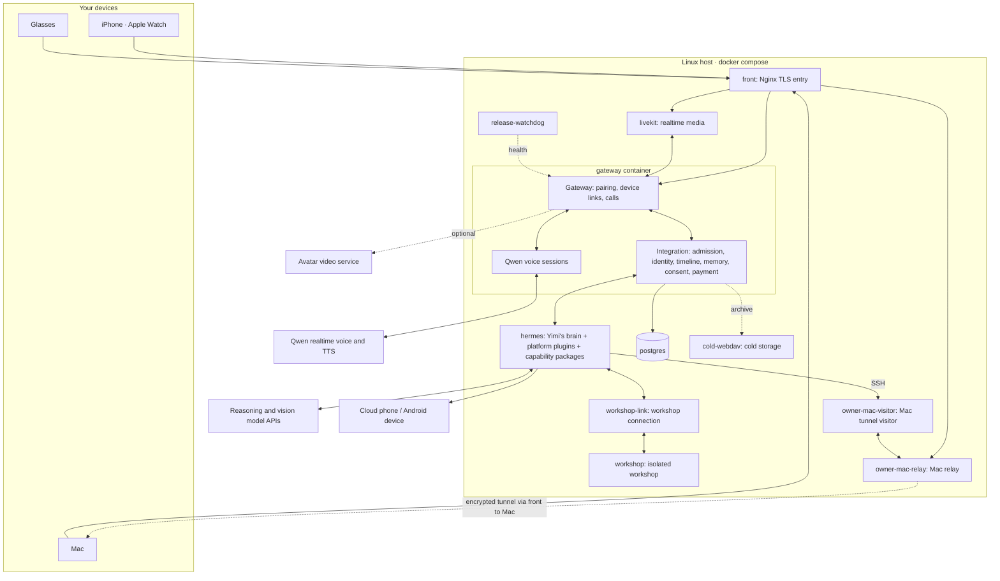

[中文](README.md) · **English**

# Yimi · Personal AI OS (Personal Agent) 0.0.2

Everyone should have their own Yimi (依米).

Yimi is a personal assistant — your own Jarvis. She lives on your phone, glasses, watch and Mac. She talks with you, takes requests, remembers what you told her and how you like things, and learns about your schedule, location and the people around you through data you authorize. Say "order the same lunch as last time" and she looks it up and does it, by default stopping right before payment to wait for your go-ahead. When she doesn't know how to do something, she looks for an existing tool and learns it; if none exists, she builds one, tests it, then uses it.

She runs on a server you deploy, uses the models you choose, and uses connected data and devices within your authorization. Models can be changed through configuration; the memory you build up with her is not cleared when the model changes.

Looking further ahead: once everyone has their own assistant, assistants could talk to each other directly — within what each user allows — to set up a dinner, find a time, or split a bill. People would then need far fewer apps and platforms to get everyday things done. That is the direction we are heading. Version 0.0.2 does not do this.

The project started in October 2026 and is licensed under Apache-2.0.

## What's new in 0.0.2

This release organizes what Yimi can do into uniform capability packages. Every capability now follows the same rules for how it is connected, how it reports its result, and how it is rolled back on its own when something goes wrong. That makes new skills easier for her to pick up, and her actions easier for you to check.

- **Capability packages.** Mi Home, phone tasks, messaging, WeChat, desktop, Mac and built-in tools all connect as capability packages. Each package can be enabled and rolled back individually (single-host peripherals also need their corresponding switches enabled); actions that need consent share one consent contract, and results come back under one receipt contract. Capability packages are this project's layer on top of Hermes, not a change to upstream Hermes.
- **Workshop.** Finding existing skills and MCP servers, checking a package against its contract, registering it and rolling it back all happen in the same workshop.
- **Model settings.** Model settings have a single source of truth. A single-host deployment imports brain, vision and workshop configuration from `.env` on its first start; later starts keep the stored settings and credentials. See "Deploying" below.
- **Usage records.** Model usage is recorded separately for input, output, cache reads and cache writes; estimates and unknown usage or costs remain marked as such.
- **Memory.** On release startup, existing Hermes native core memories are imported into personal memory. After a release rollback, the older release reads a projection of the current core memory profile; a later upgrade imports only the entries added while the older release ran.
- **Clients.** Phone, watch and Mac connection, audio and interface updates ship as source; third-party SDKs and model resources are obtained separately.
- **Contributor docs.** The community-contributed Mac desktop simulator guide and the native producer test prerequisites are kept.

## What happens after one sentence

Take one example. Wearing the glasses, you say: "Yimi, tidy up the notes from today's meeting and send them to Lin." (Lin is a made-up contact.)

1. **Wake and transcribe.** The glasses hear "Yimi" with an on-device Sherpa keyword model and stream the audio to the server. On this input path, the Qwen realtime frontend only transcribes and extracts candidates; it never answers or acts. During calls, a separate voice session reads replies aloud.
2. **Admission and identity.** The Gateway receives the input and hands it to Integration, which checks the speaker's voiceprint, confirms it is you, and writes the utterance to your personal timeline. Your phone and Mac can sync and display this timeline.
3. **Think and delegate.** Yimi's "brain" is a [Hermes Agent](https://github.com/NousResearch/hermes-agent) instance running this project's `personal_aios` platform plugin and `yimi_gateway` capability gateway plugin. The main agent talks, decides, reads memories needed for the conversation and manages delegation: she replies "OK, on it," then hands the work to a background subagent.
4. **Act.** The subagent calls tools: memory lookup, file reads, summarizing.
5. **First-send confirmation.** Before sending to Lin, the server checks for a precedent. The first time the same user sends the same kind of task to the same recipient, you confirm it on a card. After that, the same kind of send goes through without asking; a new recipient or a new kind of task asks again.
6. **Report back.** Yimi is instructed to say "sent" only after a real execution result comes back. Her reply goes to the timeline and syncs to your phone and Mac.

For a food order, step 4 goes to the phone executor instead. It opens the app on a cloud phone (or an Android device you connect) and taps through it. At the checkout screen the executor stops and the payment flow takes over; see "Safety contract" below.

## How she learns new things

- **Skills.** A skill is a `SKILL.md` that teaches her how to combine existing tools. The repository ships skills for food delivery, ride hailing, the cloud phone, Mi Home, the Mac desktop, memory recap and more (`integrations/hermes/personal_aios/errands/` and `capability/packages/*/skills/`).
- **Workshop.** When no tool fits, she finds, writes and tests a new skill in an isolated workshop container and publishes it only after the test passes; published skills can be reverted. The workshop runs in its own container and network and builds with a separate Hermes profile that carries none of your conversations or memories. New tools are built as capability packages; see [Adding capabilities](docs/skills-and-connectors.md).
- **Fixing herself.** Tell her something isn't working. Things she can change herself — phrasing, habits, skills — she changes on the spot. For product code, she can hand the problem to a separate build service. The fixed version runs the regression suite on staging, then ships at an idle moment; say "undo that" and the previous version comes back. This path requires a separately configured builder, isolated staging, a candidate repository, a release runner, credentials, snapshots and rollback. Automatic self-repair release is off in the first-run single-host entry point; see the [first-run guide](docs/first-run.md).

## What 0.0.2 contains

| Part | Delivered as | Notes |
| --- | --- | --- |
| Linux server | Source + Docker Compose | You build the images on your own host. No prebuilt images are published. |
| iPhone, Apple Watch, Mac | Source + [build guide](docs/clients.md) | Vendor assets such as the Alibaba Cloud ARTC SDK and the wake-word model are obtained separately. |
| Glasses (Android, RayNeo X series) | Source + [build guide](docs/clients.md) | The RayNeo SDK is obtained separately. This version provides source build instructions. |
| Models | Configuration | Each role has its own provider and model; see below. |

What each device does:

- **Phone:** text, voice, calls, device pairing, memory and health views, and the payment confirmation card.
- **Glasses:** voice wake, first-person photos, HUD cards, nod/shake answers, and voice payment (once enabled).
- **Watch:** talk to her from the watch, notifications, ride and workout tracking.
- **Mac:** desktop chat and screen sharing. Once paired, Yimi can read and write files, run commands and operate apps on that Mac over an encrypted relay. A keyboard shortcut pauses her control of the Mac at any time, and executed commands are logged.
- **Home:** Mi Home devices connect through a separate MCP service.

## Architecture



The main services are defined in `deploy/cloud/compose.yaml`; cold storage is defined in the referenced `compose.archive.yaml`. The main services come in `production` and `staging` profiles that use the same application images, with separate data and external-execution configuration. The single-host entry point adds `compose.single-host.yaml` and starts seven core services by default; other services in the diagram are optional. Key points:

- Only one TLS port (8443 by default for the single-host entry point) plus the WebRTC/TURN ports are exposed, all on `front`.
- Gateway, Integration and the Qwen voice sessions share one container; the process entry point is `rayneo-persistent-production-entrypoint.ts`.
- Besides Hermes itself, the `hermes` container loads MCP services through capability packages; the phone executor (built on Mobilerun), Mi Home service and Mac connection are enabled according to configuration.
- `workshop` sits on its own Docker network with a read-only root filesystem and memory and process limits, reachable only through `workshop-link`.
- Speech recognition and voiceprint models (Sherpa) and face recognition (OpenCV) run locally on the server. Completed archive data are packed and uploaded to cold storage (OpenList WebDAV). Local copies are kept for two days by default; under storage pressure, a notice precedes early cleanup of verified local copies.

For the module map and a reading order, see [the architecture guide](docs/architecture.md).

## Models are configuration

Yimi is not tied to one model vendor. Each role is configured separately. Keys never go into source or images: deployment keys live in a secrets directory and are mounted read-only into containers under `/run/secrets/`, and the provider keys for brain, vision and workshop are imported into encrypted storage on first start.

The single-host entry point configures seven roles in `deploy/cloud/.env`. Only brain is required. The example uses the official DeepSeek API; any OpenAI-compatible Chat Completions endpoint can be configured instead. Vision, executor fast, executor thorough, realtime, TTS and workshop repair are off by default. When no separate repair role is set, the workshop uses the configured brain. Brain, vision and workshop settings are imported from `.env` only on first start; after that the stored settings apply, and you change them on the client's model and key settings page. The phone executor, realtime and TTS keep reading their own read-only deployment configuration. The table below lists underlying service configuration; see the [first-run guide](docs/first-run.md) for single-host roles and protocol requirements.

| Role | Where | Default |
| --- | --- | --- |
| Main conversation, background subagents | `model` and `delegation` in `deploy/cloud/hermes-product-config.yaml` | DeepSeek |
| Vision | `auxiliary.vision` in the same file | GLM hosted on SiliconFlow |
| Realtime voice and calls | `voice_frontend` in `deploy/cloud/cloud.json` | Qwen Omni realtime |
| Read-aloud | `tts` in `cloud.json` | Qwen TTS |
| Phone executor | `integrations/connectors/phone_executor/mobilerun-config.example.yaml` | DeepSeek + GLM |

Yimi's voice comes from Qwen's speech models, called through Alibaba Cloud DashScope. This project did not train them. If you change the voice model or voice, check that the protocol and any saved voice resources still match.

## Safety contract

- **Sending:** the first time the same user sends the same kind of task to the same recipient, you confirm; the record is kept on the server. A new recipient or task type asks again. Any external action you did not ask for needs confirmation every time.
- **Payment:** each payment gets its own authorization; an earlier approval never carries over. By default every payment needs a tap on the phone's confirmation card (the phone must be unlocked, and the device signs the approval). Two options are off by default, and their amount limits are configurable:
  - *Voiceprint payment*, enabled from the phone. It requires an enrolled voiceprint, the phone and glasses lock requirements, and a valid unlock lease. Then you can confirm a recent voice request made on the same terminal by saying "付吧" ("go ahead and pay") on the phone or glasses. Defaults: known payee only, at most ¥200 per order, within the request budget.
  - *Small automatic payments.* All of these must hold: voiceprint payment enabled, a recent voiceprint-verified voice request, a valid unlock lease, a known payee, the request budget respected, at most ¥50 per order and ¥150 per day by default, and no other payment to that payee created in the past 30 minutes that is authorized, in progress, paid or of unknown outcome. The payment then goes through after a 5-second undo window.

  Anything that fails these checks falls back to the phone card.
- **What the gates cover:** built-in phone tasks and message sending are gated on the server. Tools she builds herself, terminal scripts and send paths without a code gate rely on her calling the consent check first; the system does not intercept every program.
- **Secrets:** never in source or images. Deployment keys are mounted as files; model provider keys imported on first start are stored encrypted, and the model-settings master key is mounted only into the Gateway.
- **Costs and data:** model, cloud-phone and avatar services cost money and receive the content each task needs. Set budgets with your providers and choose them to fit your data requirements. Never publish pairing data, sessions, health data, media, consent records or runtime directories.

## Deploying

A single host needs Linux, Docker Engine, Buildx and Docker Compose 2.36 or later. Run the start command as root on the deployment host, with access to the Docker daemon. The workshop preparer allocates a dedicated 1 GiB ext4 capacity volume for the workshop and configures its mount, so the host also needs Python 3, e2fsprogs, util-linux and systemd. See the [first-run guide](docs/first-run.md) for requirements, ports, pairing and a text round trip. From the repository root, as root:

```sh
cp deploy/cloud/.env.example deploy/cloud/.env
chmod 600 deploy/cloud/.env
# Edit .env: set PAIOS_BRAIN_API_KEY and configure your host/IP as needed.
sh deploy/cloud/build.sh --up
```

This command builds images from public source, generates missing internal credentials and default self-signed TLS, applies migrations, creates the instance identity and starts seven core services. Text conversation is the default. Voice, peripherals, cold storage and avatar services need additional configuration from the guide. Existing credentials and certificates are preserved. `prepare-build.py` prepares build inputs, and `hermes-init.py` writes configured models, skill directories and MCP servers into Hermes configuration.

Model configuration in `.env` is imported only on the first start: brain, vision and workshop settings, together with their provider keys, go into the model-settings authority. Later starts keep the stored settings and credentials, and editing `.env` does not overwrite them; change models or keys on the client's model and key settings page.

Once running, `release.py` takes a new release through build, tests, staging, switch and rollback. Each host uses `current` and `previous` pointers for the current and previous releases. If a release that `release-watchdog` has taken over stays unhealthy or keeps restarting, the watchdog switches back to the previous one automatically. A rollback restores images and release files. So that the older release can still read your memory, the release rollback flow first projects the current core memory profile to it, and a later upgrade imports only the entries added during the rollback. A rollback does not undo database changes, client updates or external actions that already happened. Back up your data before deploying (back up and restore the model-settings authority together with its master key) and rehearse a restore in an isolated environment.

## Where the code is

| Directory | Contents |
| --- | --- |
| `01-product-half-finished/backend/phase0/gateway` | Device access, pairing, realtime calls |
| `01-product-half-finished/backend/services/personal-aios-integration` | Admission, identity, timeline, memory, consent, payment |
| `capability` | Capability packages, contracts, receipt SDKs and templates |
| `integrations/hermes/personal_aios` | Hermes platform integration, persona, skills and workshop |
| `integrations/connectors/phone_executor` | Phone executor and checkout guard |
| `01-product-half-finished/apple/current-mac-source-20260930/clients/phase0/apple-native` | iPhone, watch and Mac clients |
| `01-product-half-finished/glasses-android` | Glasses client |
| `deploy/cloud` | Containers, config generation, release and data-snapshot tools |

## Contributing

Start with [CONTRIBUTING](CONTRIBUTING.md) and [the testing guide](docs/testing.md). Public CI needs no model keys; model calls in public CI hit local stubs. Using Node 24.19.0 and pnpm 11.9.0, run a quick first test from the repository root:

```sh
cd 01-product-half-finished/backend/phase0/gateway
pnpm install --frozen-lockfile
node --test tests/activity-update-contract.test.ts
```

This checks the shared protocol only. Calls, device permissions, external execution and recovery still need verifying on your own host and devices. Report security issues through the [private channel](SECURITY.md).

## License

Except where individual files or [NOTICE](NOTICE) say otherwise, the code is licensed under the [Apache License 2.0](LICENSE). The Mi Home MCP service, `capability/packages/mijia/server/mijia.py`, is GPL-3.0-or-later and runs as a separate process. The default avatar depicts an AI-generated fictional person; see NOTICE. Other third-party dependencies, models, SDKs and assets keep their own licenses.
