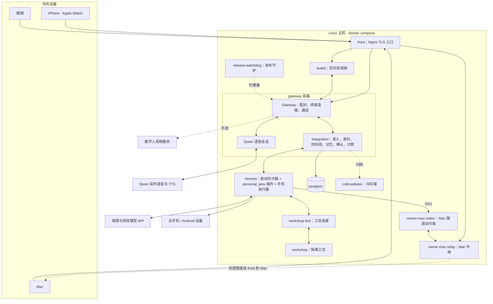

**中文** · [English](README.en.md)

# 依米 · Personal AI OS 0.0.1

让每个人都有自己的依米。

依米是一个私人助理，像只属于你一个人的贾维斯。她住在你的手机、眼镜、手表和 Mac 里，跟你说话、听你吩咐，记得你说过的事和你的习惯，通过你授权接入的数据了解你的日程、位置和身边的人。你说一句“帮我点份和上次一样的午饭”，她去查、去办，默认办到付款前停下来等你点头。她不会的事，会自己去找现成的工具学，找不到就自己做一个，试好了再用。

她跑在你自己部署的服务器上，用你选择的模型，按你的授权使用接入的数据和设备。模型可以通过配置切换，你和她之间积累的记忆不随模型切换而清空。

再往远一点看：如果每个人都有自己的助理，助理之间就可以在各自使用者授权的范围内直接商量事情，比如约一顿饭、对一下时间、分一笔账。到那时，人不必为每件事去打开一个 App 或平台。这是我们想走的方向，0.0.1 还没有这项能力。

项目始于 2026 年 10 月，采用 Apache-2.0 许可。

## 一句话之后发生了什么

拿一个例子走一遍：你戴着眼镜说“依米，把今天会上那份资料整理一下，发给小林”（小林是虚构的联系人）。

1. **唤醒和听写。** 眼镜在本地用 Sherpa 关键词模型听到“依米”，把语音送到服务器。在这条输入通路上，Qwen 实时语音前端只做转写、提取候选，既不回答，也不执行；通话时朗读回复的是另一个语音会话。
2. **准入和身份。** Gateway 收下这条输入，交给 Integration。Integration 用声纹核对说话人，确认是你之后，把这句话写进你的个人时间线。手机和 Mac 可以同步查看这条时间线。
3. **思考和分工。** 依米的“大脑”是一个 [Hermes Agent](https://github.com/NousResearch/hermes-agent) 实例，加载了本项目的 `personal_aios` 插件。主代理负责跟你说话、做判断、读取交谈所需的记忆和管理委派：她先回你一句“好，我去整理”，再把整理和发送交给后台子代理去做。
4. **动手。** 子代理调用工具，查记忆、读文件、写摘要。
5. **首次发送确认。** 要发给小林时，服务器先查有没有先例：同一个你、同一个收件人、同一类任务，第一次发送要你确认，你会收到一张确认卡。确认过一次，以后同样的事不再问；换了人或换了任务类型，会重新问。
6. **回报结果。** 依米应当拿到真实的执行结果后才说“发好了”。这句回复写回时间线，同步到你的手机和 Mac。

换成点外卖，第 4 步会交给手机执行器：它在一台云手机（或你接入的 Android 设备）上打开 App，一步步点下去。走到收银台时执行器会停下，改由付款流程接手，见下面的“安全约定”。

## 她怎样学会新本事

- **技能。** 技能就是一份 `SKILL.md`，教她怎样组合已有的工具办成一件事。仓库里自带外卖、打车、云手机、米家、Mac 桌面、记忆回顾等技能（`integrations/hermes/personal_aios/errands/`）。
- **工坊。** 遇到没有现成工具的事，她在隔离的工坊容器里找、写、测试新技能，测试通过后才发布；发布过的技能可以撤回。工坊跑在单独的容器和网络里，构建时用一份独立的 Hermes 配置，不带你的对话和记忆。
- **修自己。** 你跟她说“哪里不好用”，她能改的（说法、习惯、技能）当场改。产品代码的问题，她可以交给独立的构建服务去修。修好的版本先在预发环境跑完回归，再挑空闲时上线；你说一句“改回去”，就回到上一个版本。这条路需要部署者另外配置构建服务、隔离预发、候选源码仓库、发布 runner、凭据及快照回滚。首次单机入口关闭自动自修复发布，见 [首次运行指南](docs/first-run.md)。

## 0.0.1 里有什么

| 部分 | 交付形式 | 说明 |
| --- | --- | --- |
| Linux 服务端 | 源码 + Docker Compose | 部署者在自己的主机上构建镜像，本版本不提供预构建镜像。 |
| iPhone、Apple Watch、Mac | 源码 + [构建说明](docs/clients.md) | 阿里云 ARTC SDK、唤醒词模型等供应商资源需要按说明另行获取。 |
| 眼镜（Android，RayNeo X 系列） | 源码 + [构建说明](docs/clients.md) | RayNeo SDK 需另行获取；本版本提供源码构建说明。 |
| 模型 | 配置 | 每个角色单独配置服务商和模型，见下文。 |

各设备分工：

- **手机**：文字、语音、通话、设备配对、记忆和健康查看，以及付款确认卡。
- **眼镜**：语音唤醒、第一视角拍照、HUD 卡片、点头摇头作答，语音付款（需开启）。
- **手表**：在手表上跟她说话、看通知、骑行和运动记录。
- **Mac**：桌面对话、共享屏幕；配对后，依米可以经加密中继在这台 Mac 上读写文件、执行命令、操作应用。你可以用快捷键随时暂停她操作电脑，执行过的命令都留有记录。
- **家里**：米家设备通过独立的 MCP 服务接入。

## 系统架构



主要服务定义在 `deploy/cloud/compose.yaml`，冷存储定义在其引用的 `compose.archive.yaml`。主要服务分成 `production` 和 `staging` 两个 profile，预发和正式版用同一份应用镜像，但数据和外部执行配置隔离。单机入口叠加 `compose.single-host.yaml`，默认启动七个核心服务；图中的其他服务按需开启。几个要点：

- 对外只开一个 TLS 端口（单机入口默认 8443）和 WebRTC/TURN 端口，都在 `front` 上。
- Gateway、Integration 和 Qwen 语音会话在同一个容器里，进程入口是 `rayneo-persistent-production-entrypoint.ts`。
- `hermes` 容器里除了 Hermes 本身，还以 MCP 服务的形式运行手机执行器（基于 Mobilerun）、米家服务和 Mac 连接。
- `workshop` 在单独的 Docker 网络里，只读根文件系统，内存和进程数有上限，只能经 `workshop-link` 被访问。
- 服务器本地跑语音识别、声纹（Sherpa）和人脸识别（OpenCV）模型；完成归档的数据会打包上传冷存储（OpenList WebDAV），本地副本默认保留两天；空间紧张时会先发出通知，再提前清理已校验的本地副本。

更细的模块地图和阅读顺序见 [架构导览](docs/architecture.zh-CN.md)。

## 模型是配置

依米不绑定某一家模型。每个角色单独配置，密钥放在密钥目录里，以只读文件挂到容器的 `/run/secrets/`，不进源码，也不进镜像。

单机入口通过 `deploy/cloud/.env` 配置七个角色。只有 brain 必填，示例使用 DeepSeek 官方 API，也可改为其他 OpenAI-compatible Chat Completions 服务；vision、executor fast、executor thorough、realtime、TTS 和 workshop repair 默认关闭。工坊未单独配置 repair 角色时使用已配置的 brain。下表列出底层服务配置；单机入口的角色配置、协议和前置条件见 [首次运行指南](docs/first-run.md#模型角色)。

| 角色 | 配置位置 | 默认 |
| --- | --- | --- |
| 主对话、后台子代理 | `deploy/cloud/hermes-product-config.yaml` 的 `model`、`delegation` | DeepSeek |
| 看图 | 同一文件的 `auxiliary.vision` | SiliconFlow 托管的 GLM |
| 实时语音、通话 | `deploy/cloud/cloud.json` 的 `voice_frontend` | Qwen Omni 实时模型 |
| 朗读 | `cloud.json` 的 `tts` | Qwen TTS |
| 手机执行器 | `integrations/connectors/phone_executor/mobilerun-config.example.yaml` | DeepSeek + GLM |

依米的声音来自 Qwen 的语音模型，经阿里云 DashScope 调用，不是本项目训练的。换语音模型或音色时，要同时确认协议和已保存的语音资源仍然匹配。

## 安全约定

- **对外发送：** 同一使用者、同一收件人、同一类任务，第一次发送要你确认，确认记录存在服务器上；换人或换类任务再确认。不是你要求的对外动作，每次都要确认。
- **付款：** 每一笔生成独立授权，旧的授权不能挪用。默认每笔都在手机上点确认卡（手机须解锁，确认带设备签名）。另有两个可选项，默认都关着，金额限额可配置：
  - *声纹付款*，在手机上开启。前提是已登记声纹、满足手机和眼镜的锁定规则、解锁租约有效。之后，对近期从同一终端发起的语音请求，你可以在手机或眼镜上说“付吧”确认。默认只限已知收款方、单笔 200 元以内，且不超过请求预算。
  - *小额免确认*。要求同时满足：已开启声纹付款、近期的语音请求经声纹核过、解锁租约有效、收款方已知、不超过请求预算、默认单笔 50 元和每天 150 元以内，并且近 30 分钟内没有创建过向同一收款方的其他已授权、支付中、已支付或结果未知的付款。满足时留 5 秒撤销时间，然后自动付款。

  条件不满足，就回到手机确认卡。
- **代码门禁的范围：** 内置的手机任务和消息发送在服务器端有门禁。她自己做的工具、终端脚本和不经代码门禁的发送路径，靠她自觉先调用确认检查；系统并不会拦住所有程序。
- **密钥：** 不写进源码和镜像，只以文件挂载。
- **费用和数据：** 模型、云手机和数字人服务会产生费用，也会收到完成任务所需的内容。请在服务商那边设好预算，按你的数据要求选择服务商。不要公开配对数据、会话、健康资料、媒体、授权记录或运行目录。

## 部署

单机主机需要 Linux、Docker Engine、Buildx 和 Docker Compose 2.36 或更新版本。完整要求、端口、配对和文字往返步骤见 [首次运行指南](docs/first-run.md)。在仓库根目录执行：

```sh
cp deploy/cloud/.env.example deploy/cloud/.env
chmod 600 deploy/cloud/.env
# 编辑 .env，填写 PAIOS_BRAIN_API_KEY，并按需配置自己的 host/IP。
sh deploy/cloud/build.sh --up
```

该命令从公开源码构建镜像，生成缺少的内部凭据和默认自签 TLS，运行迁移并创建实例身份，再启动七个核心服务。默认支持文字对话；语音、外设、冷存储和数字人需要按指南另行配置。已有凭据和证书会保留。`prepare-build.py` 准备构建输入，`hermes-init.py` 把配置的模型、技能目录和 MCP 服务写进 Hermes 配置。

上线之后，`release.py` 负责新版本的构建、测试、预发、切换和回滚。每台主机用 `current` 和 `previous` 两个指针标记当前版本和上一个版本；`release-watchdog` 发现已接管的新版本持续不健康或反复重启时，会自动切回上一个版本。回滚只恢复镜像和发布文件，不撤销数据库变更、客户端更新或已经发生的外部操作，所以部署前请备份数据，并在隔离环境里试过恢复。

## 源码在哪

| 目录 | 内容 |
| --- | --- |
| `01-product-half-finished/backend/phase0/gateway` | 设备接入、配对、实时通话 |
| `01-product-half-finished/backend/services/personal-aios-integration` | 准入、身份、时间线、记忆、确认、付款 |
| `integrations/hermes/personal_aios` | Hermes 插件、人设、技能、工坊、Mac 和米家连接 |
| `integrations/connectors/phone_executor` | 手机执行器和收银台检查 |
| `01-product-half-finished/apple/current-mac-source-20260930/clients/phase0/apple-native` | iPhone、手表、Mac 客户端 |
| `01-product-half-finished/glasses-android` | 眼镜客户端 |
| `deploy/cloud` | 容器、配置生成、发布和数据快照工具 |

## 参与

先读 [参与贡献](CONTRIBUTING.zh-CN.md) 和 [测试说明](docs/testing.md)。公开 CI 不需要模型密钥，公开 CI 中的模型调用用本地桩。使用 Node 24.19.0 和 pnpm 11.9.0，从仓库根目录先跑一个小测试：

```sh
cd 01-product-half-finished/backend/phase0/gateway
pnpm install --frozen-lockfile
node --test tests/activity-update-contract.test.ts
```

这只验证共享协议。通话、设备权限、外部执行和恢复，还需要在你自己的主机和设备上验证。安全问题请走 [私密报告渠道](SECURITY.md)。

## 许可

除单个文件和 [NOTICE](NOTICE) 另有说明的部分外，代码采用 [Apache License 2.0](LICENSE)。米家 MCP 服务 `integrations/hermes/personal_aios/mijia.py` 采用 GPL-3.0-or-later，作为独立进程运行。默认头像是 AI 生成的虚构人物，见 NOTICE。其他第三方依赖、模型、SDK 和素材遵循各自的许可证。
