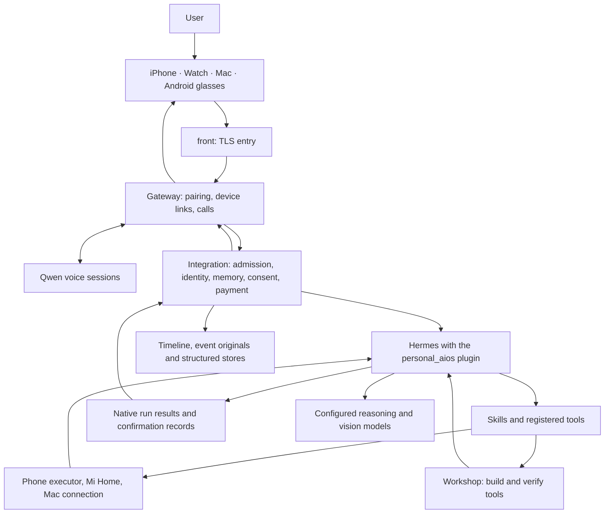

# A newcomer's map: follow one request

[简体中文](architecture.zh-CN.md) · [Contributing](../CONTRIBUTING.md) · [First run](first-run.md)

Yimi is a personal assistant that connects conversation, memory and tools across one person's devices. Version 0.0.2 contains the server and client source listed below. The server is built locally on a Linux host; the clients need their platform toolchains, and some vendor SDKs are obtained separately. External services such as cloud phones and avatar video are optional. The voice models come from Qwen; this project did not train them.

## Where a request goes

The diagram shows the main path and who owns what; not every request touches every module. A tool accepting a job does not mean the job is done. Replies to the user are based on the result records in Integration and the native Hermes run.

## Where things run

`deploy/cloud/compose.yaml` defines the main services; `compose.archive.yaml` supplies the cold-storage service and staging overrides. The table names production services. Staging counterparts use `-staging` names and separate data volumes; staging substitutes local fake phone and Mi Home servers. The optional `frpc` service uses a separate `edge-forward` profile.

| Compose service | What it holds |
| --- | --- |
| `front` | Nginx, the public HTTPS entry (port 9443 by default), plus the WebRTC/TURN ports. Several services share its network namespace. |
| `gateway` | One Node process, entry point `rayneo-persistent-production-entrypoint.ts`, hosting Gateway, Integration and the Qwen voice sessions. |
| `hermes` | Hermes Agent provides the native agent runtime and loads the platform and capability gateway plugins. When configured, the phone executor, Mi Home and the Mac connection run here as MCP servers. |
| `livekit` | Realtime audio and video. |
| `postgres` | Database-backed authorities. |
| `workshop`, `workshop-link` | The isolated workshop: its own Docker network, a read-only root filesystem, memory and process limits, reachable only through `workshop-link`. |
| `owner-mac-relay`, `owner-mac-visitor` | The Mac dials in over a WebSocket through `front`; Hermes reaches the paired Mac over SSH through this relay. |
| `cold-webdav` | OpenList WebDAV cold storage, defined in `compose.archive.yaml`. |
| `release-watchdog` | Switches back to the previous release when a new one stays unhealthy or keeps restarting. |

## Find the owning module

Paths are relative to the public checkout.

| Module | Start reading | Responsibility |
| --- | --- | --- |
| Gateway | `01-product-half-finished/backend/phase0/gateway/src/rayneo-persistent-production-entrypoint.ts` | The server process entry; binds pairing, calls and output transport. Follow its imports instead of adding another entry point. |
| Integration | `01-product-half-finished/backend/services/personal-aios-integration/src/main.ts`, then `runtime.ts` and `admission.ts` | Admits processed events, binds identity and request lineage, and coordinates memory, send consent (`effect-consent.ts`) and payment (`payment/`). |
| Capability packages | `capability/packages/`, `capability/contracts/`, `capability/sdk/` | Packages use the shared gateway, consent authorities and receipt ledger; each can be enabled and rolled back individually. |
| Hermes plugin | `integrations/hermes/personal_aios/__init__.py`, `run_api.py`, `producer.lock.json` | Registers product tools and execution gates with Hermes. `producer.lock.json` pins the Hermes version; `native-context.patch` holds the changes to it. |
| Persona and skills | `integrations/hermes/personal_aios/persona/`, `errands/`, `shared-skills/`, `skills/personal-aios-main/` | Yimi's persona and the skills that teach her to use existing tools. `deploy/cloud/hermes-init.py` wires the skill directories into Hermes. |
| Phone executor | `integrations/connectors/phone_executor/server.py`, `phone_apps.py`, `step_trace.py` | Runs bounded tasks with Mobilerun on a cloud phone or Android device and returns progress and outcome evidence. `payment_guard.py` stops ordinary task input at checkout or before an action that would charge; a bound payment intent hands control to the payment flow. |
| Workshop | `integrations/hermes/personal_aios/workshop.py`, `tool_lifecycle.py`, `deploy/cloud/workshop-scope.py` | Finds, builds, tests, publishes and reverts skills under a separate build scope. Built tools must use the existing runtime admission and consent checks. Custom tools, scripts and sends without a code gate must call `paios_effect_check` before acting. |
| Data and contracts | `01-product-half-finished/backend/contracts/`, `01-product-half-finished/backend/migrations/`, `01-product-half-finished/backend/services/platform-data/` | Wire contracts, database migrations and database-backed authorities. Media originals and derived data follow Integration's storage contracts. |
| iPhone and Watch | `01-product-half-finished/apple/current-mac-source-20260930/clients/phase0/apple-native/PersonalAIOSPhase0/OpenSource/apple-health-exporter/app/` | The iPhone app, `Core/`, shared `Contracts/` and `WatchApp/`. |
| Mac | `01-product-half-finished/apple/current-mac-source-20260930/clients/phase0/apple-native/YimiDesktop/` | Desktop client, pairing, local operations and `DesktopKit/`. |
| Glasses | `01-product-half-finished/glasses-android/app/src/main/java/com/personalaios/glasses/` | Android service, call lifecycle, first-person capture, HUD and wake word. |
| Deployment | `deploy/cloud/compose.yaml`, `deploy/cloud/compose.archive.yaml`, `deploy/cloud/hermes-init.py`, `deploy/cloud/build.sh`, `deploy/cloud/release.py` | Linux services, persisted volumes, model configuration, local builds, release and rollback. |

## A useful reading order

1. Work through the [first-run guide](first-run.md), then run one package test from [testing](testing.md).
2. Read the Gateway entry point and Integration's `main.ts`. Follow one text request through `runtime.ts`, `admission.ts` and `hermes-client.ts`.
3. Read the plugin registration, one [small skill or connector example](skills-and-connectors.md), and its existing tests.
4. Trace the result back to the device. Keep apart a queued job, a tool result, a confirmation record and the final reply.
5. Before changing media or memory, read the relevant schemas and the module that owns storage, then change the consumer.

## Shared terms

| Term | Meaning here |
| --- | --- |
| Principal | The authenticated user identity. A voice cluster or device label alone is not a principal. |
| Connector | An app or service integration exposed through an existing tool or MCP server. |
| Skill | A discoverable `SKILL.md` that teaches tool use. It grants no permission and implements no enforcement gate. |
| RawEvent / ProcessedEvent | The input/archive contract and the processed event admitted to the runtime. Preserve their lineage identifiers. |
| L1–L5 | Memory layers: L1 current context, L2 the core-profile view generated from L3 for Hermes to read, L3 structured assertions, L4 cross-device session history, L5 original event and media archives. Each has its own storage and deletion contract. |
| Run scope | The admitted execution scope, such as the user, an uncertain speaker, a guest or a build. Tool access follows the real scope. |
| First-send consent | Durable, server-kept approval for the same principal, recipient and task type. A new recipient or task type needs a new confirmation; an external action the user did not request needs one every time. |
| Payment intent | The server-side payment intent bound to one request; an intent is not a grant to pay. Default confirmation uses a signed card on an unlocked phone. Phone settings can enable voice confirmation on the phone or glasses and small automatic payments; both are off by default. Automatic payment requires an eligible voice request verified by voiceprint, a known payee, valid terminal locks and leases, and the applicable limits (defaults: ¥50 per order, ¥150 per day, with a 5-second undo window). An earlier payment or send approval cannot authorize a new payment. |
| Voiceprint gate | For captured speech, server-side speaker verification and any required confirmation determine its scope. Typed requests and the explicit server-controlled user override are separate identity paths. A skill cannot upgrade an uncertain or guest run to user scope. |
| Workshop | The isolated place where tools are built and tested; it is not a second runtime authority. |
| Receipt / outcome | An authoritative record of what happened. Starting a job, or writing a plausible summary, does not prove it was done. |
