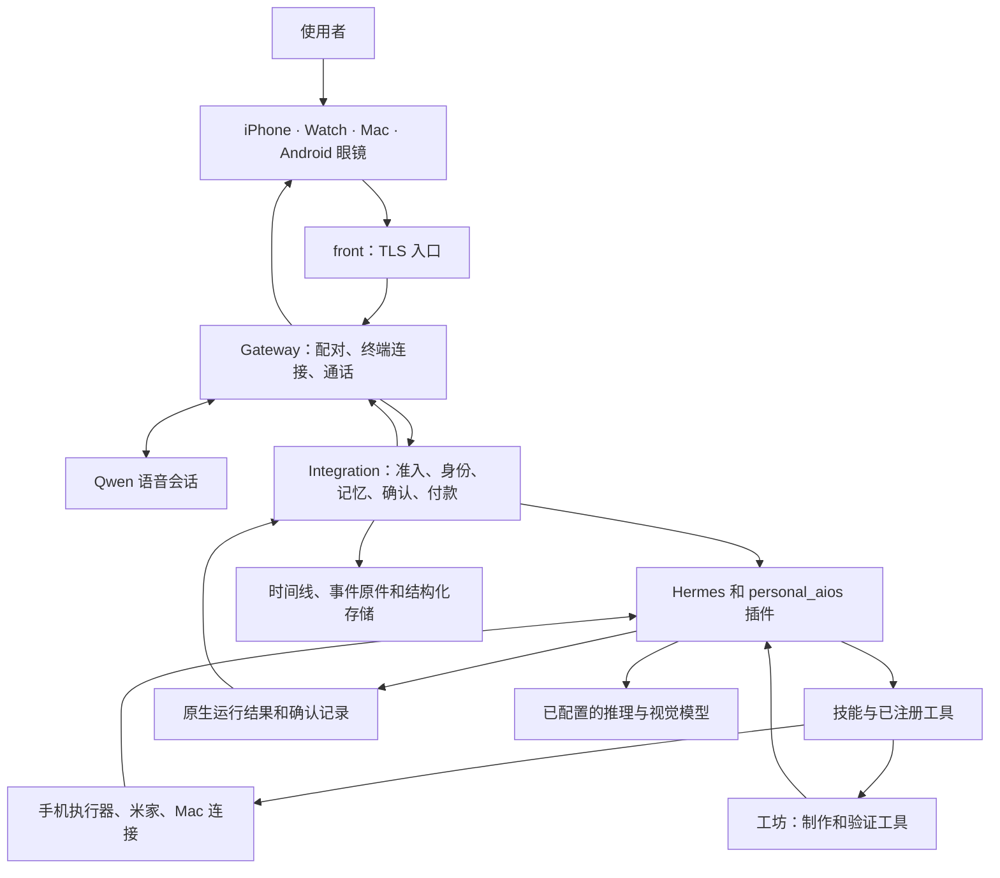

# 新手导览：跟着一个请求看懂系统

[English](architecture.md) · [参与贡献](../CONTRIBUTING.zh-CN.md) · [首次运行](first-run.md)

依米是每个人自己的私人助理，她把对话、记忆和工具连到同一个人的各台设备上。0.0.2 包含下面列出的服务端和客户端源码。服务端在 Linux 主机上本地构建；客户端要用各平台的工具链，部分供应商 SDK 需要另外获取。云手机、数字人等外部服务按需接入。语音模型来自 Qwen，不是本项目训练的。

## 一个请求经过哪里

图里画的是主要链路和各自职责，不是说每个请求都会走遍所有模块。一个工具“接下了任务”不等于“办成了”。回给使用者的话，以 Integration 和 Hermes 原生运行里的结果记录为准。

## 它们跑在哪里

主要服务在 `deploy/cloud/compose.yaml` 里；`compose.archive.yaml` 提供冷存储服务和 staging 覆盖。下表用的是 production 服务名；staging 里的对应服务带 `-staging` 后缀、用独立数据卷，手机和米家换成本地模拟服务。可选的 `frpc` 服务使用单独的 `edge-forward` profile。

| Compose 服务 | 里面是什么 |
| --- | --- |
| `front` | Nginx，对外的 HTTPS 入口（默认端口 9443），以及 WebRTC/TURN 端口。其他几个服务共用它的网络命名空间。 |
| `gateway` | 一个 Node 进程，入口 `rayneo-persistent-production-entrypoint.ts`，同时承载 Gateway、Integration 和 Qwen 语音会话。 |
| `hermes` | Hermes Agent 提供原生代理运行时，加载平台适配和能力网关插件；配置后，手机执行器、米家和 Mac 连接作为 MCP 服务在这里运行。 |
| `livekit` | 实时音视频。 |
| `postgres` | 数据库里的权威记录。 |
| `workshop`、`workshop-link` | 隔离工坊：单独的 Docker 网络、只读根文件系统、内存和进程数上限，只能经 `workshop-link` 访问。 |
| `owner-mac-relay`、`owner-mac-visitor` | Mac 经 `front` 的 WebSocket 连进来，Hermes 通过这条中继用 SSH 访问已配对的 Mac。 |
| `cold-webdav` | OpenList WebDAV 冷存储，定义在 `compose.archive.yaml`。 |
| `release-watchdog` | 发布守护：新版本持续不健康或反复重启时，切回上一个版本。 |

## 到哪里读代码

下面都是公开仓库里的相对路径。

| 模块 | 从哪读起 | 负责什么 |
| --- | --- | --- |
| Gateway | `01-product-half-finished/backend/phase0/gateway/src/rayneo-persistent-production-entrypoint.ts` | 服务端进程入口，连接配对、通话和结果传输。沿着现有导入往下读，不要另起入口。 |
| Integration | `01-product-half-finished/backend/services/personal-aios-integration/src/main.ts`，再看 `runtime.ts`、`admission.ts` | 接收处理后的事件，绑定身份和请求来源，协调记忆、发送确认（`effect-consent.ts`）和付款（`payment/`）。 |
| 能力包 | `capability/packages/`、`capability/contracts/`、`capability/sdk/` | 包通过共同的网关接入既有授权与回执账本；各包可单独启停和回退。 |
| Hermes 插件 | `integrations/hermes/personal_aios/__init__.py`、`run_api.py`、`producer.lock.json` | 向 Hermes 注册产品工具和执行门禁。Hermes 的版本由 `producer.lock.json` 锁定，改动由 `native-context.patch` 给出。 |
| 人设与技能 | `integrations/hermes/personal_aios/persona/`、`errands/`、`shared-skills/`、`skills/personal-aios-main/` | 依米的人设，以及教她怎样使用已有工具的技能。技能目录由 `deploy/cloud/hermes-init.py` 配置进 Hermes。 |
| 手机执行器 | `integrations/connectors/phone_executor/server.py`、`phone_apps.py`、`step_trace.py` | 用 Mobilerun 在云手机或 Android 设备上执行有边界的任务，返回进度和结果证据。`payment_guard.py` 在进入收银台后或触发扣款的动作前停止普通任务输入；绑定付款意图后交给付款流程。 |
| 工坊 | `integrations/hermes/personal_aios/workshop.py`、`tool_lifecycle.py`、`deploy/cloud/workshop-scope.py` | 在独立的构建作用域里寻找、制作、测试、发布和撤回技能。做出来的工具必须使用已有的运行时准入和确认检查。自制工具、脚本和未接入代码门禁的发送，执行前必须调用 `paios_effect_check`。 |
| 数据与合同 | `01-product-half-finished/backend/contracts/`、`01-product-half-finished/backend/migrations/`、`01-product-half-finished/backend/services/platform-data/` | 线上协议、数据库迁移和数据库中的权威记录。媒体原件和派生数据遵循 Integration 的存储合同。 |
| iPhone 与 Watch | `01-product-half-finished/apple/current-mac-source-20260930/clients/phase0/apple-native/PersonalAIOSPhase0/OpenSource/apple-health-exporter/app/` | iPhone 应用、`Core/`、共享的 `Contracts/` 和 `WatchApp/`。 |
| Mac | `01-product-half-finished/apple/current-mac-source-20260930/clients/phase0/apple-native/YimiDesktop/` | 桌面客户端、配对、本机操作和 `DesktopKit/`。 |
| 眼镜 | `01-product-half-finished/glasses-android/app/src/main/java/com/personalaios/glasses/` | Android 服务、通话生命周期、第一视角采集、HUD 界面和唤醒词。 |
| 部署 | `deploy/cloud/compose.yaml`、`deploy/cloud/compose.archive.yaml`、`deploy/cloud/hermes-init.py`、`deploy/cloud/build.sh`、`deploy/cloud/release.py` | Linux 服务、持久卷、模型配置、本地构建和发布回滚。 |

## 建议的阅读顺序

1. 按 [首次运行指南](first-run.md) 跑通环境，再跑 [测试说明](testing.md) 里的一个包级测试。
2. 读 Gateway 入口和 Integration 的 `main.ts`，再沿 `runtime.ts`、`admission.ts`、`hermes-client.ts` 跟一条文字请求走一遍。
3. 看插件注册、[一个小技能或连接器例子](skills-and-connectors.md)，以及它现有的测试。
4. 跟着结果回到终端。分清“任务排上队”“工具返回结果”“确认记录”和“最终回复”这几件事。
5. 改媒体或记忆之前，先读相关 schema 和负责存储的模块，再改消费方。

## 常用词

| 名称 | 在这个仓库里的意思 |
| --- | --- |
| Principal | 认证后的使用者身份。一个声音聚类或设备名本身不能证明身份。 |
| Connector / 连接器 | 通过已有工具或 MCP 服务接进来的应用或服务。 |
| Skill / 技能 | 可被发现的 `SKILL.md`，教助理怎样用工具。它不授予权限，也不实现安全门禁。 |
| RawEvent / ProcessedEvent | 输入与归档合同，以及被准入运行时的处理后事件。改动时保留它们的来源标识。 |
| L1–L5 | 记忆分层：L1 当前上下文，L2 由 L3 生成、供 Hermes 读取的核心资料视图，L3 结构化断言，L4 跨终端的会话历史，L5 事件和媒体原件归档。各层的存储和删除合同不同。 |
| Run scope / 运行作用域 | 准入后的执行范围，例如使用者本人、身份不确定、访客或构建。工具权限跟着真实作用域走。 |
| 首次发送确认 | 同一身份、同一收件人、同一类任务的持久授权，记录在服务器上。换人或换类任务要重新确认；不是使用者要求的对外动作，每次都确认。 |
| Payment intent / 付款意图 | 绑定到这一次请求的服务端付款意图；创建意图不等于准许扣款。默认在已解锁的手机上点签名确认卡。可在手机设置里开启手机或眼镜上的语音确认，以及小额自动付款；两项默认关闭。自动付款要求声纹核实的合格语音请求、已知收款方、有效终端锁和租约，并满足适用限额（默认每单 50 元、每日 150 元，提供 5 秒撤回窗口）。以前的付款或发送授权不能批准新的付款。 |
| 声纹门禁 | 对采集到的语音，服务端声纹核实和必要确认决定运行作用域。文字请求和显式启用的服务端使用者覆盖开关是另外的身份路径。技能不能把身份不确定或访客运行升级成使用者作用域。 |
| Workshop / 工坊 | 隔离制作和测试工具的地方，不是第二套运行时权威。 |
| 收据 / 结果记录 | 说明实际发生了什么的权威记录。任务开始了，或者写出一段像样的总结，都不能证明办成了。 |
